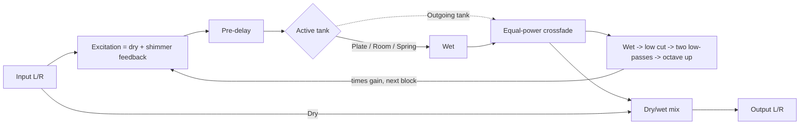

# OnlyObsessionRemained

A reverb plugin for JUCE 8 (VST3 + standalone). Three mutually independent
reverb algorithms — Plate, Room and Spring — plus shimmer, eight parameters,
and a 960×520 vector HUD.

> Source comments are in Chinese. The Chinese README is the default:
> [README.md](README.md).

**English** | [中文](README.md)

## Download

Prebuilt Windows x64 binaries are on the [Releases](../../releases) page:
a standalone `.exe` and the VST3.

- Standalone: unzip and run the `.exe`.
- VST3: on Windows this is a bundle directory
  (`OnlyObsessionRemained.vst3/Contents/x86_64-win/`). Copy the whole
  `OnlyObsessionRemained.vst3` folder into `C:\Program Files\Common Files\VST3`,
  not just the inner file.

## Parameters

| Parameter | Range | Default | What it does |
| --- | --- | --- | --- |
| Type | Plate / Room / Spring | Plate | Selects the tank; switching crossfades over 120 ms |
| Mix | 0 – 100 % | 30 % | Wet/dry, equal-power law |
| Decay | 0 – 100 % | 40 % | `RT60 = 0.25 × 120^decay` seconds, identical across all three tanks |
| Pre-Delay | 0 – 500 ms | 20 ms | Wet pre-delay, fractional-sample accurate |
| Mod | 0 – 100 % | 50 % | Depth of the slow modulation on the read pointers |
| High Damp | 0 – 100 % | 50 % | High-frequency loss in the feedback path |
| Low Damp | 0 – 100 % | 20 % | Low-frequency loss in the feedback path |
| Shimmer | 0 – 100 % | 0 % | How much octave-up wet signal is fed back |

## Signal flow



Stage by stage:

1. **Excitation** — the dry signal plus the previous block's shimmer feedback,
   written to a separate input buffer so the dry signal stays untouched.
2. **Pre-delay** — inside the tank, not on the dry path; it reads fractionally,
   so changing it does not click.
3. **Tank** — the feedback loop contains damping (a blend of low-pass and
   high-pass), a fixed 15 Hz DC blocker and a soft saturator. The three tanks
   differ structurally (below) but share the same interface and calibration.
4. **Crossfade** — both tanks run for 120 ms with sin/cos equal-power gains; the
   outgoing tank is only cleared once it is silent. A switch requested mid-fade
   is queued.
5. **Shimmer** — takes the current wet signal, applies a low cut and two 5 kHz
   low-passes for darkening, runs a 2× oversampled octave-up shifter, and feeds
   it back as next block's excitation. The low cut is required: tank DC gain can
   reach `1/(1-g)` and pitch shifting does not move DC, so without it the loop
   diverges.
6. **Mix** — dry × `√(1-mix)`, wet × `√mix`, with a wet level compensation that
   tracks Decay so loudness stays roughly constant.
7. **Smoothing** — High/Low Damp, Mod and Pre-Delay are smoothed at block level
   over ~40 ms, avoiding zipper noise from filter coefficients and read pointers
   jumping under automation.

## Architecture

| Module | Responsibility |
| --- | --- |
| `Source/dsp/ReverbEngine` | Top-level scheduling: block splitting, parameter smoothing, type crossfade, shimmer routing, dry/wet mix |
| `Source/dsp/tanks/PlateTank` | Plate: Dattorro figure-8 topology, seven taps to stereo |
| `Source/dsp/tanks/RoomTank` | Room: 8-line feedback delay network with a Householder mixing matrix |
| `Source/dsp/tanks/SpringTank` | Spring: 48-stage allpass dispersion chain inside the feedback loop |
| `Source/dsp/core` | Fractional delay line, allpass, one-pole low/high pass, triangle LFO, soft saturator, octave pitch shifter |
| `Source/params/ParameterSchema.h` | Single source of truth for the eight parameters |
| `Source/presets` | Factory presets and preset manager |
| `Source/ui/HudView` | All UI drawing and interaction, including the layout editor |
| `Source/ui/ShaderBackground` + `HudSceneShader.h` | Optional GPU scene-shader background and its CPU fallback |
| `Source/ui/SkinBundle` | Skin manifest parsing (the default skin uses no textures) |
| `Source/ui/WindowShaper` | Window region clipping and frameless window (standalone only) |
| `offline/PlateOfflineTest.cpp` | JUCE-free verification harness |

Deliberate implementation choices:

- **Damping is a blend, not a series filter**: `y = x + k·(filtered − x)`. At
  `k = 0` the path is bit-transparent, so "no damping" means the same thing in
  all three algorithms and RT60 values are comparable.
- **Loop gains are calibrated per delay line** so every line reaches −60 dB
  together. One shared gain would let short lines decay first and leave the tail
  dominated by the longest line.
- **Room modal density**: eight mutually prime lengths summing to about 0.90 s
  at 48 kHz, satisfying `Σm ≥ 0.15·RT60·fs` up to roughly 6 s of RT60.
- **Block splitting**: `process` splits anything longer than the prepared maximum
  block, so an oversized host block is no longer silently passed through dry.
- **No allocation or locks on the audio thread**: buffers are allocated once in
  `prepare`; the audio thread only reads atomics.

## Interface

- Controls are drawn entirely as JUCE vector graphics; there are no static bitmaps.
  The three blocks (faders, Mix, Shimmer) can each be translated, scaled and
  rotated.
- The background is an optional GPU scene shader (embedded in `HudSceneShader.h`).
  `Ctrl+Shift+S` toggles it; if the GPU cannot compile it, the editor falls back
  to a plain black background without affecting control drawing or feel.
- `Ctrl+Shift+L` opens the layout editor; drag to move, and the result is written
  to `hud-layout.json` (versioned) in the user data directory.
- The built-in look is described by `skins/default/skin.json` (colours, fonts,
  rects, labels). The skin system supports PNG texture slots, but the default
  skin uses none of them.

## Build

```sh
cmake -S . -B build -DCMAKE_BUILD_TYPE=Release
cmake --build build --config Release
ctest --test-dir build --output-on-failure
```

Requirements: CMake 3.22+, a C++17 compiler, and network access on the first
configure — JUCE 8.0.15 is fetched with `FetchContent` and pinned to that tag.
On Windows, build from a Visual Studio developer shell.

Artifacts (Ninja/Release):

| Target | Path |
| --- | --- |
| Standalone | `build/OnlyObsessionRemained_artefacts/Release/Standalone/OnlyObsessionRemained.exe` |
| VST3 | `build/OnlyObsessionRemained_artefacts/Release/VST3/OnlyObsessionRemained.vst3` |

With the Visual Studio generator both live under
`build/OnlyObsessionRemained_artefacts/Release/`. `-DSKIN_NAME=<dir>` picks which
`skins/<dir>` gets packed into the binary; the default is `default`.

## Offline verification

`plate_offline_test` links only the three tanks — no JUCE, no host — and runs 22
checks:

- impulse response: peak, first arrival, echo density, RT60 by EDC extrapolation
- Decay → RT60 calibration for all three tanks, and monotonicity in Decay
- High Damp shortens the high band, Low Damp the low band
- wet/dry loudness at the default setting
- pre-delay first arrival shifts by exactly the requested number of samples
- stability at extreme settings (no NaN, no self-oscillation)
- spring dispersion: low frequencies arrive measurably later than high ones
- pitch shifter octave-up spectrum and anti-aliasing fold-back level
- saturator curve properties, THD across levels, and compression on hot signals

## License

GNU AGPL-3.0, Copyright (C) 2026 ElecHex — see [LICENSE](LICENSE). AGPL-3.0
matches JUCE's open-source licensing path; shipping this plugin in a closed-source
product requires a commercial JUCE licence.
