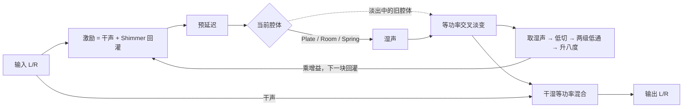

# OnlyObsessionRemained

基于 JUCE 8 的混响插件（VST3 + 独立程序）。三种彼此独立的混响算法 —— Plate、Room、Spring —— 外加 Shimmer，8 个参数，界面是 960×520 的矢量 HUD。

> 源码注释为中文；本文件是默认（中文）说明，英文版见 [README.en.md](README.en.md)。

**中文** | [English](README.en.md)

## 下载

Windows x64 预编译包见 [Releases](../../releases)：Standalone 的 `.exe` 与 VST3。

- 独立程序：解压后直接运行 `.exe`。
- VST3：Windows 上是 bundle 目录（`OnlyObsessionRemained.vst3/Contents/x86_64-win/`），整个目录放进 `C:\Program Files\Common Files\VST3`，不要只拷贝里面那个文件。

## 参数

| 参数 | 范围 | 默认 | 作用 |
| --- | --- | --- | --- |
| Type | Plate / Room / Spring | Plate | 选择腔体；切换时 120 ms 等功率交叉淡变 |
| Mix | 0 – 100 % | 30 % | 干湿比，等功率律 |
| Decay | 0 – 100 % | 40 % | 衰减时间，三种腔体统一映射为 `RT60 = 0.25 × 120^decay` 秒 |
| Pre-Delay | 0 – 500 ms | 20 ms | 湿声预延迟，分数样本精度 |
| Mod | 0 – 100 % | 50 % | 延迟读取指针的慢速调制深度 |
| High Damp | 0 – 100 % | 50 % | 反馈路径里的高频衰减 |
| Low Damp | 0 – 100 % | 20 % | 反馈路径里的低频衰减 |
| Shimmer | 0 – 100 % | 0 % | 湿声升八度后回灌腔体的量 |

## 音频链路



逐段说明：

1. **激励**：干声加上上一块的 Shimmer 回灌量，写入独立的输入缓冲，不污染干声。
2. **预延迟**：位于腔体内部，干路不经过；预延迟参数用分数样本读取，改变时不会跳变。
3. **腔体**：反馈环里依次是阻尼（低通/高通的混合）、15 Hz 直流阻断、软饱和。三种腔体的结构不同（见下），但接口与标定一致。
4. **交叉淡变**：切换 Type 时新旧两个腔体同时运行 120 ms，sin/cos 等功率交叉；旧腔体在完全静音后才被清空。淡变中途再次切换会排队。
5. **Shimmer**：取当块湿声，先低切再经两级 5 kHz 低通柔化，然后由 2× 过采样的升八度移调器处理，乘环路增益后作为下一块的激励回灌。低切是必需的：腔体的直流增益可达 `1/(1-g)`，而移调对直流无效，没有这道阻断时环路会发散。
6. **混合**：干声乘 `√(1-mix)`、湿声乘 `√mix`（等功率），湿声额外乘一个随 Decay 变化的电平补偿，使升 Decay 时响度基本不变。
7. **平滑**：High/Low Damp、Mod、Pre-Delay 在引擎层做约 40 ms 的块级平滑，避免自动化时滤波器系数与延迟读指针硬跳产生 zipper。

## 实现架构

| 模块 | 职责 |
| --- | --- |
| `Source/dsp/ReverbEngine` | 顶层调度：切块、参数平滑、Type 交叉淡变、Shimmer 路由、干湿混合 |
| `Source/dsp/tanks/PlateTank` | Plate：Dattorro figure-8 拓扑，7 路抽头立体声输出 |
| `Source/dsp/tanks/RoomTank` | Room：8 条互质延迟线的反馈延迟网络，Householder 无损混合 |
| `Source/dsp/tanks/SpringTank` | Spring：反馈环内 48 级全通色散链 |
| `Source/dsp/core` | 分数延迟线、全通、一阶低/高通、三角 LFO、软饱和器、升八度移调器 |
| `Source/params/ParameterSchema.h` | 8 个参数的唯一事实源（范围、默认值、显示名、引擎换算） |
| `Source/presets` | 出厂预设与预设管理 |
| `Source/ui/HudView` | 全部界面绘制与交互，含版式编辑层 |
| `Source/ui/ShaderBackground` + `HudSceneShader.h` | 可选的 GPU 场景着色器背景与 CPU 回退 |
| `Source/ui/SkinBundle` | 皮肤清单解析（默认皮肤不使用贴图） |
| `Source/ui/WindowShaper` | 窗口区域裁剪与无标题栏（仅 Standalone） |
| `offline/PlateOfflineTest.cpp` | 不依赖 JUCE 的离线验证 harness |

几处刻意的实现选择：

- **阻尼是混合而非串联滤波**：`y = x + k·(filtered − x)`，`k = 0` 时路径逐比特透明，所以"不加阻尼"在三种算法里含义一致，RT60 可横向比较。
- **环路增益按延迟线逐条标定**，让每条线同时衰减到 −60 dB；共享一个增益会让短线先衰完、尾巴被最长线占据。
- **Room 的模态密度**：8 条互质长度合计约 0.90 s（48 kHz），满足 `Σm ≥ 0.15·RT60·fs`，可支撑约 6 s 的 RT60。
- **切块处理**：`process` 按 `prepare` 时的最大块长切分，宿主送来超长块时不会静默直通。
- **热路径无分配、无锁**：缓冲在 `prepare` 里一次性分配，音频线程只做原子读写。

## 界面

- 控件全部由 JUCE 矢量绘制，没有静态底图；三个板块（推子组 / MIX / Shimmer）可各自平移、缩放、旋转。
- 背景是一层可选的 GPU 场景着色器（源码内嵌在 `HudSceneShader.h`）。`Ctrl+Shift+S` 开关；GPU 不可用时退回纯黑底，控件绘制与手感不受影响。
- `Ctrl+Shift+L` 打开版式编辑层，拖动即改布局，结果写入用户数据目录下的 `hud-layout.json`（带版本号）。
- 内置外观由 `skins/default/skin.json` 描述（颜色、字体、矩形、文案）。皮肤系统支持 PNG 贴图槽位，默认皮肤不使用任何贴图。

## 构建

```sh
cmake -S . -B build -DCMAKE_BUILD_TYPE=Release
cmake --build build --config Release
ctest --test-dir build --output-on-failure
```

要求：CMake 3.22+、支持 C++17 的编译器；首次配置需要联网 —— JUCE 8.0.15 由 `FetchContent` 拉取并锁死在该 tag。Windows 上请在 Visual Studio 开发者命令行里构建。

产物（Ninja/Release）：

| 目标 | 路径 |
| --- | --- |
| 独立程序 | `build/OnlyObsessionRemained_artefacts/Release/Standalone/OnlyObsessionRemained.exe` |
| VST3 | `build/OnlyObsessionRemained_artefacts/Release/VST3/OnlyObsessionRemained.vst3` |

用 Visual Studio 生成器时，这两个位于 `build/OnlyObsessionRemained_artefacts/Release/` 下。`-DSKIN_NAME=<目录名>` 可切换打包进二进制的皮肤，默认 `default`。

## 离线验证

`plate_offline_test` 只链接三个腔体，不需要 JUCE 也不需要宿主，共 22 项检查：

- 冲激响应：峰值、首次到达、回声密度、由 EDC 外推的 RT60
- 三个腔体的 Decay → RT60 标定、RT60 随 Decay 单调
- High Damp 缩短高频带，Low Damp 缩短低频带
- 默认参数下的湿/干响度
- 预延迟的首次到达偏移精确到样本
- 极值参数下的稳定性（无 NaN、无自激）
- 弹簧色散：低频可测地晚于高频到达
- 移调器的升八度频谱与抗混叠折返电平
- 饱和器曲线性质、各电平下的 THD、热信号压缩量

## 许可

GNU AGPL-3.0，Copyright (C) 2026 ElecHex，见 [LICENSE](LICENSE)。选择 AGPL-3.0 与 JUCE 的开源授权路径一致：如果你要把本插件用于闭源产品，需要另行取得 JUCE 的商业授权。
